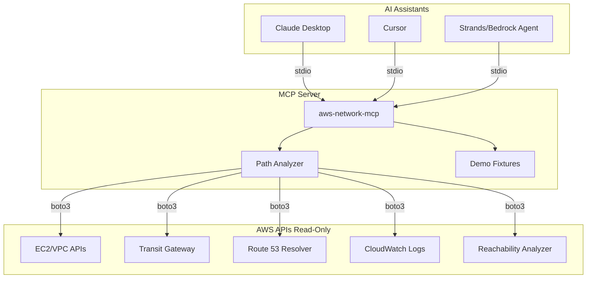

# AWS Network MCP

An MCP (Model Context Protocol) server that lets AI assistants troubleshoot AWS and hybrid network connectivity. Point Claude, Cursor, or any MCP-compatible agent at this server and ask: **"Why can't A talk to B?"**

I built this after years of debugging Transit Gateway routing issues, security group reference chains, and those infuriating NACL stateless return-traffic problems. The goal is to give AI assistants the same mental model I use when tracing packets through AWS infrastructure.

## The Problem

AWS networking is powerful but complex. When connectivity fails, you need to check:

- Security groups (stateful, but SG-to-SG references can be tricky)
- NACLs (stateless! return traffic needs explicit rules)
- VPC route tables (longest-prefix match, blackholes)
- Transit Gateway route tables (associations, propagations, segmentation)
- VPN tunnel and BGP status
- Route 53 Resolver forwarding rules

This server walks through each hop programmatically and identifies the exact blocking rule.

## Architecture



## Quick Start

### Installation

```bash
pip install aws-network-mcp
```

Or from source:

```bash
git clone https://github.com/harindersingh/aws-network-mcp
cd aws-network-mcp
pip install -e .
```

### Demo Mode (No AWS Required)

```bash
make demo
# or
python -m aws_network_mcp.demo
```

### Claude Desktop Configuration

Add to `~/Library/Application Support/Claude/claude_desktop_config.json` (macOS):

```json
{
  "mcpServers": {
    "aws-network": {
      "command": "python",
      "args": ["-m", "aws_network_mcp.server"],
      "env": {
        "AWS_PROFILE": "your-profile",
        "AWS_REGION": "us-east-1"
      }
    }
  }
}
```

### Cursor Configuration

```json
{
  "mcpServers": {
    "aws-network": {
      "command": "python",
      "args": ["-m", "aws_network_mcp.server"]
    }
  }
}
```

## Sample Troubleshooting Session

Using the `missing_tgw_propagation` demo scenario:

```
User: Why can't 10.2.0.100 reach 10.1.0.50 on port 443?
Assistant: I'll analyze the path from 10.2.0.100 to 10.1.0.50 on port 443/tcp.

[Calling explain_connectivity tool...]

**Verdict: DENY**

Path analysis:
  1. [✓] security_group: sg-dev-app-001 - Allowed by egress rule
  2. [✓] nacl: acl-dev-001 - Allowed by rule #100
  3. [✓] route_table: rtb-dev-001 - Matched route 10.0.0.0/8 -> tgw-demo-001
  4. [✗] transit_gateway: tgw-rtb-dev-002 - No TGW route found for 10.1.0.50

**Root Cause**: The dev VPC's Transit Gateway route table (tgw-rtb-dev-002) 
doesn't have a route to the prod VPC (10.1.0.0/16). The prod VPC attachment 
is not propagating routes to this route table.

**Fix**: Enable route propagation from tgw-attach-prod-001 to tgw-rtb-dev-002,
or add a static route for 10.1.0.0/16 pointing to the prod attachment.
```

## Available Tools

| Tool | Description |
|------|-------------|
| `describe_path` | Full hop-by-hop path analysis with blocking rule identification |
| `explain_connectivity` | Human-readable connectivity explanation (simplified interface) |
| `run_reachability_analysis` | AWS Reachability Analyzer (~$0.10 per analysis) |
| `tgw_route_lookup` | Longest-prefix match in a TGW route table |
| `list_tgw_attachments` | List TGW attachments with state |
| `inspect_vpn_bgp` | VPN tunnel status, BGP state, DX VIF status |
| `check_dns_resolution` | Route 53 Resolver forwarding rules for a domain |
| `query_flow_logs` | Search VPC Flow Logs for a 5-tuple |

## Demo Scenarios

The demo includes 5 broken scenarios for troubleshooting practice:

| Scenario | Issue |
|----------|-------|
| `missing_tgw_propagation` | TGW route table missing VPC propagation |
| `blackhole_route` | TGW route pointing to deleted attachment |
| `sg_missing_return_rule` | Security group reference to wrong SG |
| `sg_wrong_port` | Security group allows 80 but app needs 443 |
| `nacl_blocking_ephemeral` | NACL missing return traffic rule (stateless!) |

Load a scenario:
```bash
# In an MCP session
load_demo_scenario(scenario_name="nacl_blocking_ephemeral")
```

## IAM Permissions

The server requires read-only access. See `iam/policy.json` for the minimal policy.

Key permissions:
- `ec2:Describe*` for VPCs, subnets, route tables, security groups, NACLs
- `ec2:*TransitGateway*` for TGW resources
- `route53resolver:List*`, `route53resolver:Get*` for DNS
- `logs:StartQuery`, `logs:GetQueryResults` for Flow Logs

Optional (adds ~$0.10/analysis cost):
- `ec2:*NetworkInsights*` for Reachability Analyzer

## Cost Considerations

- **Path analysis**: Free (uses cached/fixture data or read-only API calls)
- **VPC Reachability Analyzer**: ~$0.10 per path analyzed
- **CloudWatch Logs Insights**: Standard query pricing applies

The server is read-only by design. It cannot modify any AWS resources.

## Security

- Read-only access only - no modifications possible
- No credentials stored - uses standard AWS credential chain
- Demo mode available for testing without AWS access
- All analysis is deterministic and auditable

## Lab Environment

For hands-on testing, deploy the example Terraform:

```bash
cd examples/terraform
terraform init
terraform apply

# Test with the MCP server
# ...

terraform destroy  # Don't forget to clean up!
```

See `examples/terraform/README.md` for details on the intentional misconfigurations.

## Development

```bash
# Install dev dependencies
pip install -e ".[dev]"

# Run linting
make lint

# Run type checking
make typecheck

# Run tests
make test

# Run all CI checks
make ci
```

## Roadmap

- [ ] Network Firewall rule analysis
- [ ] PrivateLink endpoint analysis
- [ ] Cross-account TGW support
- [ ] VPC Lattice integration
- [ ] Terraform state correlation
- [ ] Interactive path visualization

## License

MIT License - see LICENSE file.

## Author

Harinder Singh - Cloud Infrastructure and SRE Leader

This project demonstrates practical AWS networking expertise combined with AI-assisted operations tooling.
