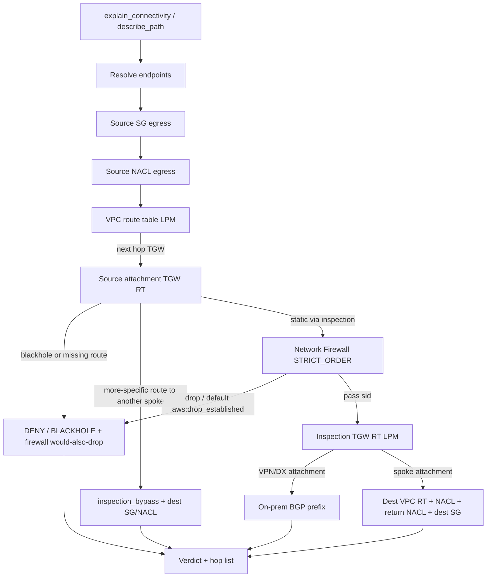

# AWS Network MCP

Offline and live **hybrid path analysis** for AWS Transit Gateway hubs. Given two endpoints, the server reports each hop and the exact route or rule that allowed or dropped the flow.

This is not a clone of AWS Labs' [`awslabs.aws-network-mcp-server`](https://github.com/awslabs/mcp/tree/main/src/aws-network-mcp-server). That server inventories live Cloud WAN, Transit Gateway, VPC, Network Firewall, and VPN APIs (several TGW route tools require Network Manager registration). This server evaluates a 5-tuple against Transit Gateway route tables (static, propagated, blackhole), inspection VPC / AWS Network Firewall `STRICT_ORDER` policy, security groups, NACLs, and on-prem prefixes learned over VPN or Direct Connect BGP.

Companion Terraform hub: [aws-hybrid-network-landing-zone](https://github.com/harin-singh/aws-hybrid-network-landing-zone).

## Analysis flow



## Install

The package is not on PyPI. Install from source:

```bash
git clone https://github.com/harin-singh/aws-network-mcp.git
cd aws-network-mcp
python3 -m pip install -e .
```

Or run the console script from git with uv:

```bash
uvx --from git+https://github.com/harin-singh/aws-network-mcp aws-network-mcp
```

Demo mode (no AWS credentials):

```bash
make demo
# or
python3 -m aws_network_mcp.demo
```

## Connect from an MCP client

Set `AWS_NETWORK_MCP_DEMO=true` for the landing-zone fixtures. Omit it and provide an AWS profile: the server describes the region and builds a topology for hop-by-hop analysis.

Cursor (`~/.cursor/mcp.json` or project MCP config):

```json
{
  "mcpServers": {
    "aws-network": {
      "command": "python3",
      "args": ["-m", "aws_network_mcp.server"],
      "env": {
        "AWS_NETWORK_MCP_DEMO": "true"
      }
    }
  }
}
```

From a local clone with live credentials:

```json
{
  "mcpServers": {
    "aws-network": {
      "command": "python3",
      "args": ["-m", "aws_network_mcp.server"],
      "env": {
        "AWS_PROFILE": "your-profile",
        "AWS_REGION": "us-east-1"
      }
    }
  }
}
```

Claude Desktop (`~/Library/Application Support/Claude/claude_desktop_config.json` on macOS) uses the same `mcpServers` object. Example files: `examples/config-cursor.json`, `examples/config-claude-desktop.json`.

## Sample session (from `python3 -m aws_network_mcp.demo`)

`missing_tgw_propagation`: prod `10.10.0.10` to on-prem `10.200.1.50:443`. Traffic reaches inspection; the inspection TGW route table has no VPN-propagated prefix.

```
Test: 10.10.0.10 → 10.200.1.50:443/tcp
Verdict: DENY

  1. [✓] security_group: sg-prod-app-001
      Allowed by SG sg-prod-app-001 egress rule: destination=0.0.0.0/0, port=all, protocol=-1
  2. [✓] nacl: acl-prod-001
      Allowed by NACL acl-prod-001 rule #100 (egress): 0.0.0.0/0 port all
  3. [✓] route_table: rtb-prod-001
      Matched route 0.0.0.0/0 -> transit-gateway:tgw-demo-001
  4. [✓] transit_gateway: tgw-rtb-prod-001
      Matched TGW route 10.200.0.0/16 -> vpc:tgw-attach-inspection-004 (static)
  5. [✓] network_firewall: nfw-policy-inspection-001
      Allowed by Network Firewall ... rule sid:2000005 (Allow prod to onprem)
  6. [✗] transit_gateway: tgw-rtb-inspection-004
      Inspection return/forward lookup: No TGW route found for 10.200.1.50
      BLOCKING: missing route propagation or static route on inspection RT
```

`prod_nonprod_blocked`: prod `10.10.0.10` to nonprod `10.20.0.10:443`. The packet is dropped by a static TGW blackhole; the analyzer also reports the matching Network Firewall drop.

```
Verdict: BLACKHOLE
  4. [⚫] transit_gateway: tgw-rtb-prod-001
      TGW route to 10.20.0.0/24 is blackholed
      route/rule: 10.20.0.0/24 -> none (static, blackhole)
      BLOCKING: static blackhole route 10.20.0.0/24
Additional findings:
  - Defense in depth: Network Firewall ... would also drop this flow via sid:1000001
```

## Tools

| Tool | Description |
|------|-------------|
| `describe_path` | Hop-by-hop path analysis with the matching route or rule at each hop |
| `explain_connectivity` | Same analysis as readable text from two IP addresses |
| `run_reachability_analysis` | AWS Reachability Analyzer (~$0.10 per analysis) |
| `tgw_route_lookup` | Longest-prefix match in a TGW route table |
| `list_tgw_attachments` | TGW attachments and associated route tables |
| `inspect_vpn_bgp` | VPN tunnel / BGP and Direct Connect VIF status |
| `check_dns_resolution` | Route 53 Resolver forwarding for a domain |
| `query_flow_logs` | CloudWatch Logs Insights over VPC Flow Logs |
| `load_demo_scenario` / `list_demo_scenarios` | Offline landing-zone and misconfig fixtures |

## Demo scenarios

Fixtures follow [aws-hybrid-network-landing-zone](https://github.com/harin-singh/aws-hybrid-network-landing-zone) CIDRs: inspection `10.0.0.0/24`, shared `10.1.0.0/24`, prod `10.10.0.0/24`, nonprod `10.20.0.0/24`, on-prem BGP `10.200.0.0/16`.

| Scenario | Expected result |
|----------|-----------------|
| `missing_tgw_propagation` | DENY — VPN prefix not on the inspection RT |
| `blackhole_route` | BLACKHOLE — inspection RT blackholes `10.200.0.0/16` |
| `prod_nonprod_blocked` | BLACKHOLE on prod RT + firewall sid:1000001 |
| `nonprod_onprem_blocked` | BLACKHOLE on nonprod RT + firewall sid:1000003 |
| `spoke_onprem_via_inspection` | ALLOW via inspection, firewall sid:2000005, BGP VPN route |
| `inspection_bypass_propagation` | ALLOW, but a propagated spoke prefix skips the firewall |
| `sg_missing_return_rule` | DENY — dest SG references the wrong source SG |
| `sg_wrong_port` | DENY — dest SG allows 80, flow is 443 |
| `nacl_blocking_ephemeral` | DENY — stateless NACL missing ephemeral return |

```bash
# After connecting an MCP client in demo mode
load_demo_scenario(scenario_name="prod_nonprod_blocked")
explain_connectivity(source_ip="10.10.0.10", dest_ip="10.20.0.10", port=443)
```

## IAM

Read-only. `iam/policy.json` is the minimal policy for live hop-by-hop analysis:

- EC2 describe of VPCs, subnets, route tables, security groups, NACLs, ENIs, Transit Gateway attachments/route tables (`SearchTransitGatewayRoutes`, associations, propagations), VPN, and managed prefix lists
- Direct Connect virtual-interface describe
- Network Firewall `ListFirewalls`, `DescribeFirewall`, `DescribeFirewallPolicy`, `DescribeRuleGroup`
- Route 53 Resolver and CloudWatch Logs Insights (inventory tools, not required for path analysis)

Optional `iam/policy-reachability-analyzer.json` adds Reachability Analyzer (creates/deletes paths; billed per analysis).

## Lab environment

Deploy the companion hub rather than the old two-VPC lab in this repo:

```bash
git clone https://github.com/harin-singh/aws-hybrid-network-landing-zone.git
cd aws-hybrid-network-landing-zone/examples/complete
```

See that repository for cost, `terraform apply`, and `scripts/test-connectivity.sh`.

## Development

```bash
python3 -m pip install -e ".[dev]"
make lint
make typecheck
make test
make demo
make ci
```

Dependencies are pinned in `pyproject.toml`. CI runs ruff, mypy, pytest (including an stdio `list_tools` / `call_tool` smoke test), pip-audit, gitleaks, terraform fmt, Checkov, and `pre-commit run --all-files`. Checkov skips for account-wide describe APIs are listed in `.checkov.yaml`.

## Local development

Hook versions match CI (`ruff==0.17.3`, `mypy==1.19.1`, `gitleaks v8.18.4`).

```bash
python3 -m pip install -e ".[dev]"
pre-commit install
pre-commit run --all-files
# or
make pre-commit
```

## Known limitations

- Live hop-by-hop analysis loads a regional topology at process start via `LiveTopologyLoader` (EC2 describe APIs + Network Firewall policy import). The process uses `AWS_REGION` / the boto3 session region only; other regions are not scanned.
- Network Firewall import evaluates `STRICT_ORDER` stateful 5-tuple / Suricata headers: `pass`/`drop`/`reject`, `ip`/`tcp`/`udp`/`icmp`, CIDR/`any`/`$HOME_NET`/`!$HOME_NET`, optional dest ports, `sid`, `msg`. Unsupported and skipped: `alert`; application inspectors (`http`/`tls`/`dns`); `content`/`pcre`/`flow`/`byte_*`/`threshold`/`xbits`/`dataset`/`geoip`; domain-list rule groups (`TLS_SNI`/`HTTP_HOST`); stateless rule groups (only `StatefulDefaultActions` apply after stateful rules). Import notes are logged and returned as `topology_warnings` on `describe_path`.
- On-prem CIDRs come from TGW routes toward VPN or Direct Connect attachments and from VPN static routes. Customer-gateway ACLs and on-prem firewalls are not evaluated.
- Direct Connect is modeled as a TGW attachment type. There is no DX Gateway / transit VIF topology builder.
- IPv6, PrivateLink, VPC Lattice, and cross-account RAM-shared attachments are out of scope.
- VPC Reachability Analyzer is optional and billed by AWS (~$0.10 per path).
- This server does not replace AWS Labs' inventory, flow-log, or Cloud WAN tools.

## License

MIT License — see LICENSE.

## Author

Harinder Singh
